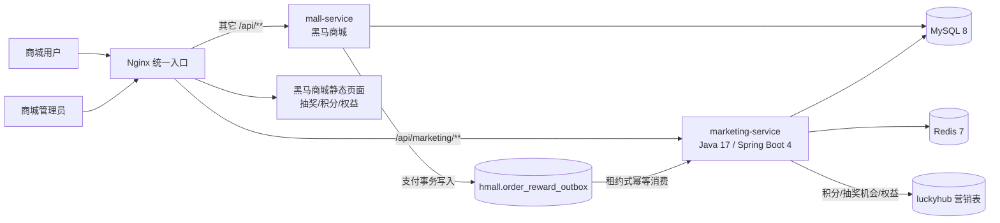
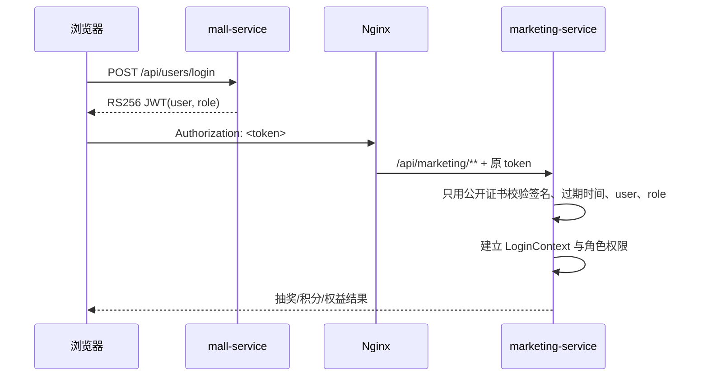
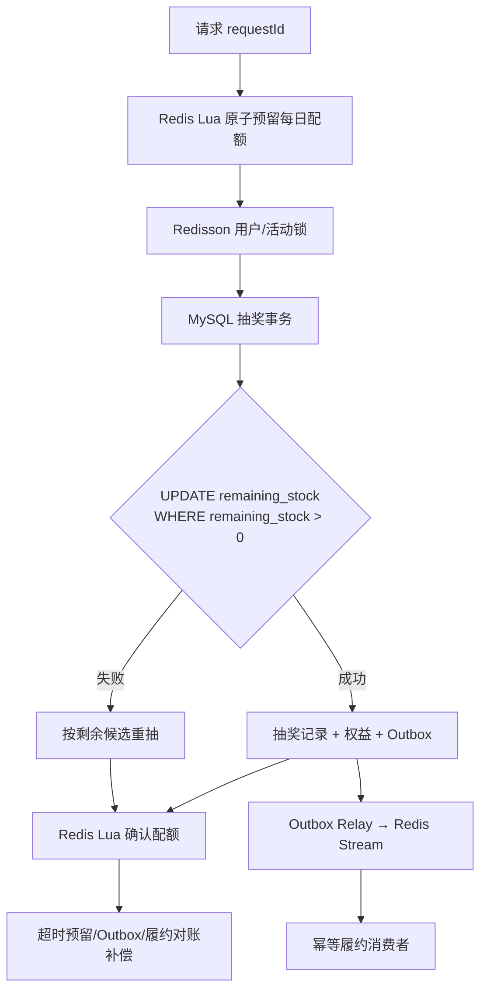

# 黑马商城 × LuckyHub 融合架构

## 1. 目标与边界

- 黑马商城继续负责：用户、商品、购物车、订单、支付和原始静态前端。
- LuckyHub 营销服务负责：活动、奖池、抽奖、积分、优惠券、会员、权益、履约、实物领奖。
- 原始 `hmall.sql` 与原始 8 张商城表不删除、不覆盖。
- 新增结构必须使用幂等增量迁移；原四个来源目录保持只读。
- LuckyHub 的 Redis Lua 配额、Redisson 锁、MySQL 条件扣库存、Outbox、Redis Stream、对账补偿链路保留。

## 2. 运行架构

## 3. 身份统一

- `role=USER`：只能访问本人的抽奖、积分、优惠券、会员和权益数据。
- `role=ADMIN`：具备活动、奖品、奖池、库存、发货等后台权限。
- 营销服务只保存公开证书，不复制黑马商城私钥。

## 4. 高并发抽奖链路（保留 LuckyHub 原实现）

> Redis 不是奖品最终库存。Redis 负责挡流量、配额和幂等预留；MySQL 条件更新是库存最终事实。

## 5. 数据库增量顺序

1. 原 `mysql/init/hmall.sql` 仅在全新数据卷首次初始化时执行，内容不修改。
2. `schema-init` 每次启动执行幂等商城增量：
   - `hmall.user.role`，默认 `USER`；演示管理员 `id=1` 为 `ADMIN`。
   - `hmall.order_reward_outbox`，保存支付成功奖励事件。
   - 创建 `luckyhub` 数据库与最小跨库权限。
3. `marketing-service` Flyway 在 `luckyhub` 库执行原 V1～V17 营销迁移。
4. 以后所有融合结构只新增新的版本迁移，不回写或删除原商城种子数据。

## 6. 支付奖励一致性

商城支付成功事务必须同时完成：

1. 余额条件扣减（`amount > 0 AND balance >= amount`）。
2. 支付单 CAS 为成功。
3. 商城订单 CAS 为已支付。
4. 插入唯一事件 `ORDER_PAID:{payOrderId}` 到 `order_reward_outbox`。

营销服务按租约消费：

- 领取事件：`PENDING/RETRY → PROCESSING`。
- 按支付金额发放 `ORDER_REWARD` 积分；业务号唯一，重试不重复入账。
- 可按规则额外发放抽奖机会。
- 成功标记 `DONE`；失败记录原因并指数退避，租约过期可重新领取。

## 7. 前端入口

- 商城端：`/lottery.html`、`/points.html`、`/benefits.html`。
- 管理端：`/marketing.html`。
- 浏览器只通过 Nginx 的 `/api` 访问后端，不直接暴露内部服务地址。
